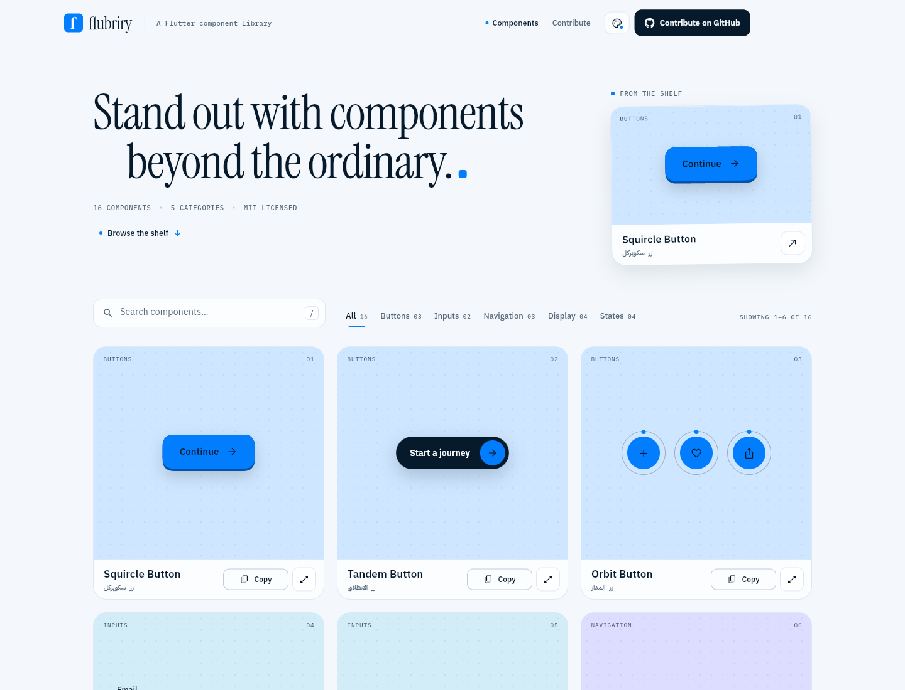
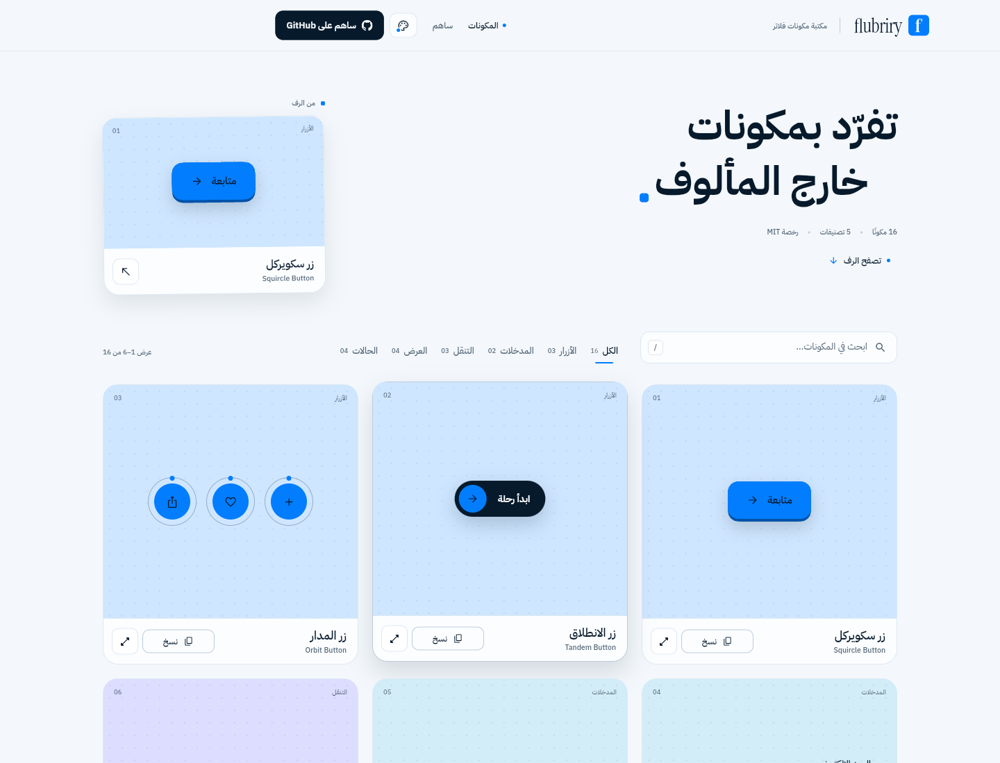
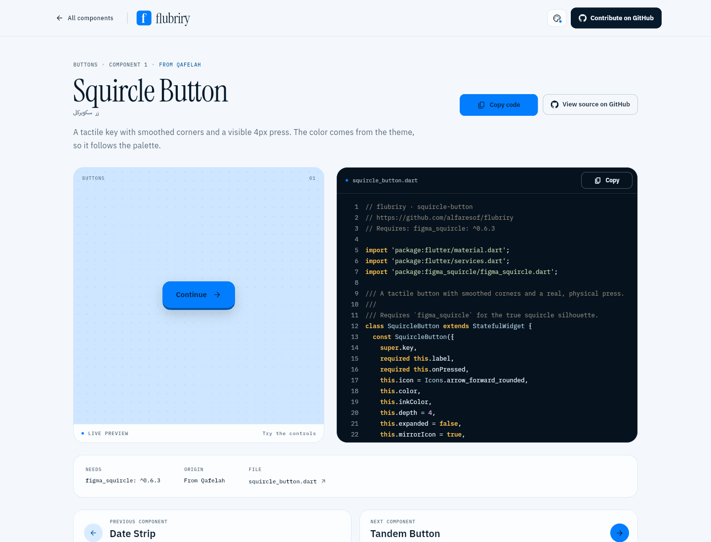
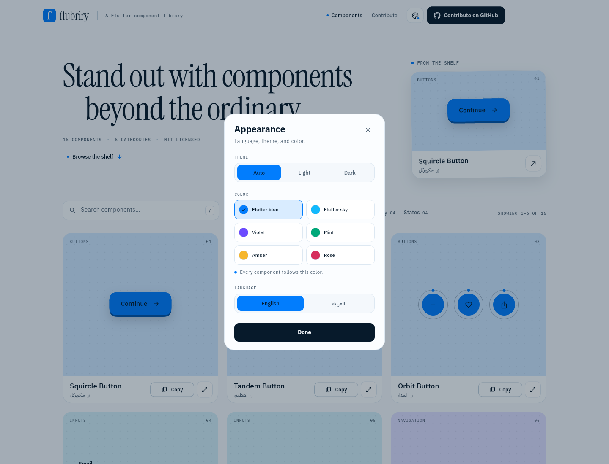
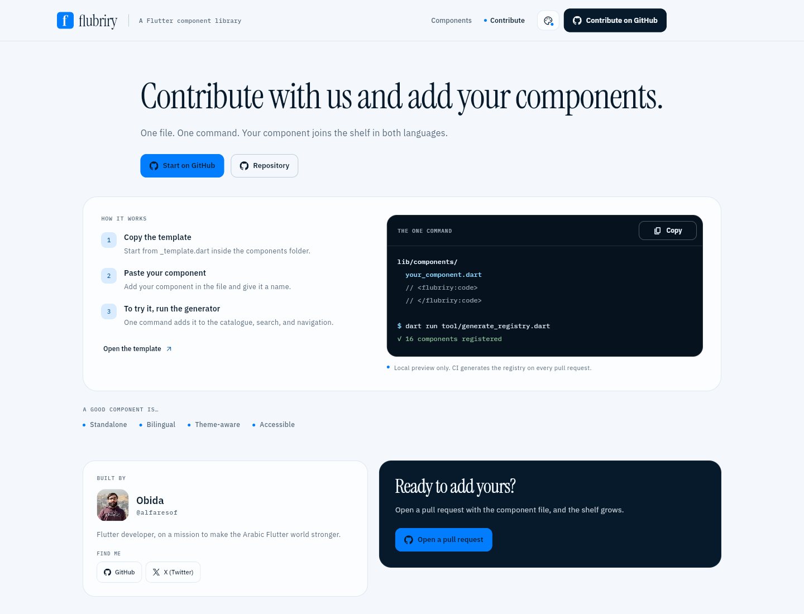

# flubriry

**Stand out with components beyond the ordinary.**

A Flutter component library in English and Arabic: sixteen live previews,
copy-ready Dart, light and dark themes, and six accent palettes — starting with
Flutter blue.

[](https://github.com/alfaresof/flubriry)





## What is inside

- **16 components** across Buttons, Inputs, Navigation, Display, and States.
- **Flutter colors by default**, with sky, violet, mint, amber, and rose
  available from the appearance panel. Changing the accent changes every
  component, and the choice is remembered.
- **English and Arabic** with real RTL layouts and translated live demos.
- **Light and dark** modes.
- **Live previews**, a clear **Copy** button, and a full page for every component
  with syntax-highlighted source.
- **Pagination** of six components per page, plus previous/next navigation on
  component pages.
- **A full contribution page** linked from the navbar.
- **Riverpod** state and an **MVC** split: models, controllers, views.
- **Accounts**: [@alfaresof](https://github.com/alfaresof) on GitHub and
  [X](https://x.com/alfaresof), in the footer and on the contribution page.
- **Repository**: [github.com/alfaresof/flubriry](https://github.com/alfaresof/flubriry),
  linked from the header, footer, and contribution page.



## Preview locally

```bash
flutter pub get
dart run tool/dev.dart
```

`tool/dev.dart` is the local preview helper. It generates the registry and then
launches Flutter (Chrome by default). In the contribution flow CI does this for
you. **Never commit the generated output.**

Checks:

```bash
flutter analyze
flutter test
flutter build web --release
```

On a fresh clone, `dart run tool/dev.dart` creates the ignored registry before the
app or these checks can run. CI runs the same generation step before every
analysis, test, and deploy.

## Fork and add your widget

This is the complete contributor flow. No code generation is required from you.

1. **Fork** the repository on GitHub, then clone your fork:

   ```bash
   git clone https://github.com/<your-user>/flubriry.git
   cd flubriry
   flutter pub get
   ```

2. **Create your component file** from the template:

   ```bash
   cp lib/components/_template.dart lib/components/my_widget.dart
   ```

3. **Paste your widget** between the copy markers and fill in its metadata:
   name, Arabic name, description, category, tags, and a unique `id`/`order`.
   Keep the metadata variable named exactly `componentMeta`.

   ```dart
   // <flubriry:code>
   class MyWidget extends StatelessWidget { ... }
   // </flubriry:code>

   final ComponentMeta componentMeta = ComponentMeta(
     id: 'my-widget',
     order: 170,
     category: ComponentCategory.buttons,
     name: const LocalizedText('My Widget', 'مكوني'),
     description: const LocalizedText(
       'What makes it worth borrowing.',
       'ما يجعله جديرًا بالاقتباس.',
     ),
     preview: (context) => const _MyPreview(),
   );
   ```

   Only the code between the markers is copied from the catalogue. The preview
   and metadata stay out of the clipboard. Components must be self-contained:
   use SDK or published packages, not relative helper imports.

4. **Try it locally** (optional):

   ```bash
   dart run tool/dev.dart
   ```

   The wrapper generates `lib/registry.g.dart` for your checkout and starts the
   app. The generated file is ignored by git. Do not commit it, do not edit it,
   and do not add it to a pull request.

5. **Commit only your source changes** — the component file, plus any new asset
   or `pubspec.yaml` dependency — then push and open a pull request.

6. **CI takes over.** Every pull request runs:

   - a guard that fails if `lib/registry.g.dart` is tracked,
   - the registry generator,
   - `flutter analyze`,
   - `flutter test`,
   - a release web build.

   The component then appears automatically in the catalogue, search, filters,
   pagination, and its own page at `/#/component/my-widget`.

### How the generator works

`tool/generate_registry.dart` scans every non-underscore Dart file in
`lib/components`. It extracts the `<flubriry:code>` section, collects the public
imports, validates the id/order/metadata, and writes `lib/registry.g.dart`.
Relative imports are rejected so copied widgets remain portable.

The generated registry is **not committed**. CI regenerates it on every pull
request and every deploy. `lib/registry.g.dart` is listed in `.gitignore`, and
the workflows fail if somebody commits it.

If your component needs a package, add it to `pubspec.yaml` and to the
`dependencies` list in its metadata. The copied code then starts with a
`// Requires:` line and the detail page shows it under “Needs”.

Files starting with `_` are ignored; that is why `_template.dart` is never part
of the catalogue.

## Components

| # | Component | Arabic | Shelf | Origin |
|---|---|---|---|---|
| 01 | Squircle Button | زر سكويركل | Buttons | Qafelah |
| 02 | Tandem Button | زر الانطلاق | Buttons | Qafelah |
| 03 | Orbit Button | زر المدار | Buttons | Qafelah |
| 04 | Field Note | حقل الملاحظة | Inputs | Qafelah |
| 05 | Tally Stepper | عدّاد الكمية | Inputs | Qafelah |
| 06 | Filter Pill | زر التصفية | Navigation | Qafelah |
| 07 | Segment Switch | قائمة انتقال | Navigation | flubriry |
| 08 | Point Badge | شارة النقاط | Display | Qafelah |
| 09 | Title Stack | كتلة العنوان | Display | Qafelah |
| 10 | Soft Toast | تنبيه ناعم | States | Qafelah |
| 11 | Empty Nest | حالة فراغ | States | flubriry |
| 12 | Progress Rail | حالة التقدم | States | flubriry |
| 13 | Crew Row | صف الفريق | Display | Khaber |
| 14 | Plan Pass | بطاقة الاشتراك | Display | Khaber |
| 15 | Access Gate | بوابة العضوية | States | Khaber |
| 16 | Date Strip | شريط التواريخ | Navigation | Khaber |

Nine are rebuilt from patterns in the
[Qafelah app](https://github.com/ryadh-sa/qafelah_app), three were made for this
shelf, and four are modeled on the team, subscription, access, and calendar
assets in the Khaber project. All sixteen are theme-aware.

## Architecture — MVC + Riverpod

```text
lib/
  models/          ← plain data: component metadata, settings, catalogue view
  controllers/     ← Riverpod notifiers and derived providers
  views/           ← library, component detail, contribute, shared chrome
  components/      ← the drop folder; one source file per catalogue component
  services/        ← localization, links, document metadata
  theme/           ← palette, typography, spacing, ThemeData
  config/          ← repository and logo configuration
  router.dart
  registry.g.dart  ← generated; ignored by git
```

- **Model** — `ComponentMeta`, `ComponentEntry`, `AppSettingsState`,
  `CatalogueState`, `CatalogueView`, and the static catalogue.
- **Controller** — `AppSettingsController` persists language, theme, and accent.
  `CatalogueController` owns search, shelf, and page; `catalogueViewProvider`
  derives the visible page without rebuilding the whole screen.
- **View** — pages and widgets watch only the slices of state they need.

Text selection is deliberately limited: reading and code surfaces can be
selected, while button and navigation labels cannot.

## Colors and appearance

Open the palette button in the navbar to switch:

- **Theme** — auto, light, or dark.
- **Color** — Flutter blue, Flutter sky, violet, mint, amber, or rose.
- **Language** — English or العربية.

The accent is stored in `SharedPreferences`; components read
`Theme.of(context).colorScheme`, so every preview updates at once.



## Brand, accounts, and the creator

The supplied mark is included at `assets/brand/logo.svg`, recolored to Flutter
blue and the site's near-white. `Site.logoAsset` in `lib/config/site.dart` points
to it. Drop a replacement in `assets/brand/` and update that constant.

The contribution page also includes the creator portrait, links to
[@alfaresof](https://github.com/alfaresof) on GitHub and X, and a direct
**Repository** link.

## The contribution page

The navbar opens a full page with the three steps, terminal example, rules for a
good component, and the GitHub actions. It is not a modal or a home-page section.



## GitHub Pages

Every merge to `main` runs `.github/workflows/deploy.yml`. It:

1. refuses a committed generated registry,
2. generates `lib/registry.g.dart` on the runner,
3. runs analyze and tests,
4. builds the site into **`build/web`**,
5. publishes that folder to the **`gh-pages`** branch,
6. keeps a downloadable `flubriry-web` artifact.

To serve it with GitHub Pages:

1. Open **Settings → Pages**.
2. Source: **Deploy from a branch**.
3. Branch: **`gh-pages`**, folder **`/ (root)`**.
4. Save. The next merge rebuilds and republishes automatically.

GitHub Pages is available for public repositories. If the repository is private
on a plan without Pages, use the `flubriry-web` artifact from the Actions run or
any static host; the build is completely static.

## Credits

- **Thmanyah Serif Display** for the provided logo glyph, converted to paths in
  `assets/brand/logo.svg`.
- **Instrument Serif** for the Latin display voice.
- **IBM Plex Sans Arabic** for the bilingual interface.
- **IBM Plex Mono** for code and catalogue metadata.
- The IBM and Instrument fonts are self-hosted under the SIL Open Font License.
- The app uses Flutter, `flutter_riverpod`, `figma_squircle`, `flutter_svg`,
  `go_router`, `shared_preferences`, `url_launcher`, and `web`.

---

## بالعربية

**flubriry** — **تفرّد بمكونات خارج المألوف.**

- **16 مكونًا** حيًّا بالعربية والإنجليزية، بوضعين فاتح وداكن.
- **ألوان فلاتر أساسًا**: أزرق فلاتر مع ست لوحات قابلة للتبديل من زر المظهر؛
  تغيير اللون ينعكس على كل المكونات ويُحفظ.
- **صفحات**: كل مكون له صفحة تفاصيل، والقائمة تعرض ستة مكونات في الصفحة مع
  تنقل بينها وبين السابق والتالي.
- **صفحة مساهمة كاملة** من شريط التنقل: انسخ القالب، الصق مكونك، وأعطه اسمًا.
  لتجربته محليًا شغّل المولد فقط؛ لا داعي لرفع الملف المولد أو تشغيل الأمر
  يدويًا في المساهمة.
- **CI هو من يولّد** `lib/registry.g.dart` في كل طلب دمج ويختبر التحليل
  والاختبارات والبناء، ويفشل إذا كان الملف المولد مرفوعًا في git.
- **حساباتي**: [@alfaresof](https://github.com/alfaresof) على GitHub وX،
  وموجودة في الفوتر وصفحة المساهمة، مع رابط مباشر للمستودع.
- **الشعار** في `assets/brand/logo.svg` بألوان الموقع، والصورة الشخصية داخل
  صفحة المساهمة.
- عند الدمج في `main` يُعاد البناء ويُنشر مجلد `build/web` إلى فرع
  `gh-pages`، ثم تختار GitHub Pages الفرع `gh-pages` والمجلد `/ (root)`.

---

MIT licensed. See [LICENSE](LICENSE).
